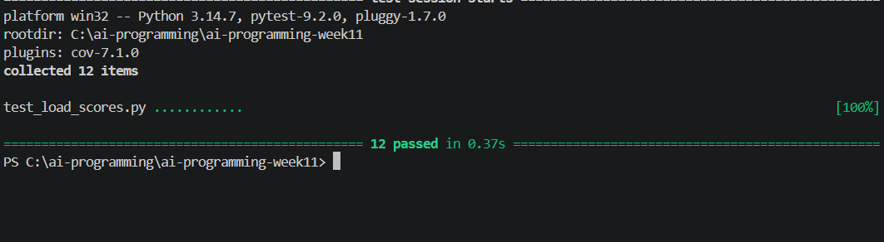

# (프로그램 이름을 적으세요)

성적관리프로그램

## ① 무엇을 하나요 (What)

CSV 파일에서 학생 이름과 점수를 읽어 유효한 점수는 저장하고, 잘못된 데이터는 건너뛰어 기록하는 프로그램입니다.

## ② 왜 만들었나요 (Why)          ★ AI는 이 칸을 못 씁니다

실제 성적 CSV 파일에는 이름이나 점수가 비어 있거나, 점수 범위를 벗어나는 데이터 등 다양한 문제가 발생할 수 있습니다. 이러한 데이터를 그대로 읽으면 프로그램이 오류를 일으키거나 잘못된 결과를 만들 수 있습니다. 따라서 잘못된 데이터는 구분하고 유효한 점수만 처리할 수 있도록 프로그램을 만들었습니다.

## ③ 어떻게 쓰나요 (How)

현재 저장소에 load_scores.py에 성적 CSV를 처리하는 load_scores(path) 함수가 있습니다.
Python 환경에서 프로젝트 폴더로 이동한 뒤 테스트를 실행하면 됩니다.

테스트 실행:
python -m pytest test_load_scores.py

## ④ 어떻게 테스트하나요

<!-- pytest 실행 방법과, 통과했을 때 나오는 화면을 붙여 넣으세요. -->

다음 명령어로 테스트를 실행

python -m pytest test_load_scores.py

## ⑤ 파일 구성

load_scores.py: 성적 CSV 파일을 읽고 유효한 데이터와 제외할 데이터를 구분

test_load_scores.py: 직접 작성한 정상·예외·경계값 테스트

test_ai_A.py: AI에게 기존 코드를 제공하여 생성한 테스트

test_ai_B.py: AI에게 명세를 제공하여 생성한 테스트

bug3_logic.py: 버그 검증을 위한 대상 코드

test_ai_bug.py: AI가 생성한 버그 검증 테스트

README.md: 프로젝트 설명과 테스트 방법을 안내

LICENSE: MIT 라이선스 파일

## ⑥ 만든 사람 · AI를 어디에 썼는지

만든 사람: 남성준 / 2006100082

AI를 쓴 곳: GitHub Copilot을 활용하여 코드 기반 테스트, 명세 기반 테스트 및 버그 검증 테스트를 생성했습니다.

내가 직접 판단한 것: 직접 테스트 코드를 만들고 실행하여 결과를 확인했으며, AI가 만든 테스트들과 비교해봤습니다.

## 라이선스

MIT License (LICENSE 파일 참고)
